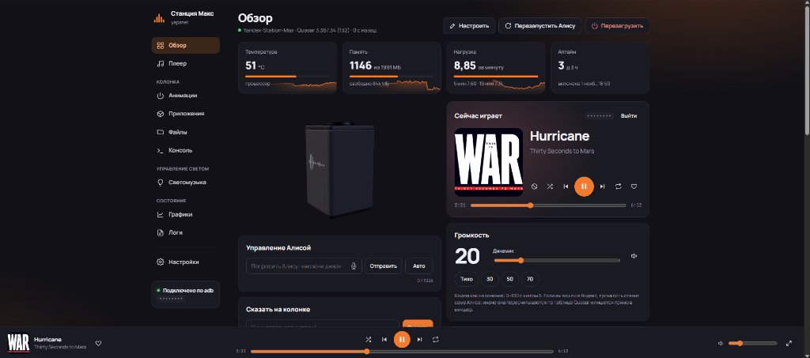

# yapanel — веб-панель для Станций

Локальная веб-панель для **Станций с root-доступом по adb**. Разрабатывалась в первую очередь под Лайт 2, но так же в некоторой степени поддерживает Лайт, Мини 3 Про, Станции 2 и Мини 3 (см. [Другие модели](#другие-модели-и-несколько-колонок)). Задачей проекта было расширить возможности колонки поверх Алисы, без установки кастомных бекендов. Многие функции работают на стороне панели, работая с колонкой по adb. На колонку ничего не ставится без разрешения пользователя

> [!WARNING]
> Неофициальный проект, не связан с Яндексом и не одобрен им. Панель работает только на колонке, где уже есть root-доступ по adb,
> и сама колонку не рутирует. Консоль, файлы и некоторые функции дают полный доступ к системе колонки:
> используйте на свой риск.



<table>
  <tr>
    <td width="50%"></td>
    <td width="50%"></td>
  </tr>
  <tr>
    <td align="center">Плеер: текст песни, очередь, похожие треки</td>
    <td align="center">Локальный будильник</td>
  </tr>
  <tr>
    <td width="50%"></td>
    <td width="50%"></td>
  </tr>
  <tr>
    <td align="center">Графики за сутки</td>
    <td align="center">Интерактивная root-консоль</td>
  </tr>
  <tr>
    <td width="50%"></td>
    <td width="50%"></td>
  </tr>
  <tr>
    <td align="center">Редактор анимаций: часы по кадрам с яркостью сегментов, кольцо</td>
    <td align="center">Свой голосовой ассистент на любой OpenAI-совместимой модели</td>
  </tr>
  <tr>
    <td width="50%"></td>
    <td width="50%"></td>
  </tr>
  <tr>
    <td align="center">Сценарии на поле нод: условия, речь Алисы, вопрос ассистенту</td>
    <td align="center">Тёмная тема</td>
  </tr>
</table>

## Содержание

- [Возможности](#возможности)
- [Что нужно](#что-нужно)
- [Установка](#установка): [Windows](#windows--запускать-когда-нужно) · [macOS](#macos--запускать-когда-нужно) · [Linux](#linux--запускать-когда-нужно) · [Docker](#docker--постоянно-на-сервере) · [Android](#android--приложение-на-телефоне)
- [Другие модели и несколько колонок](#другие-модели-и-несколько-колонок)
- [Параметры](#параметры)
- [Безопасность](#безопасность)
- [Что панель ставит на колонку](#что-панель-ставит-на-колонку)
- [Как это устроено](#как-это-устроено)
- [Благодарности и лицензии](#благодарности-и-лицензии)

## Возможности

**Основной функционал**
- **Обзор** — графики состояния колонки; 3D-модель колонки, изменяющаяся в реальном времени с визуализатор на фоне; управление громкостью, «Сказать на колонке», менеджер звуки колонки, вывод своего текста на дисплей часов. Виджеты можно переставлять и прятать по желанию.
- **Плеер** — что играет, управление, громкость,текст песни (Яндекс Музыка или [LRCLIB](https://lrclib.net)), очередь, похожие треки, об исполнителе.
  Для работы с Яндекс Музыкой необходим вход. Музыку с телефона по Bluetooth плеер тоже показывает.
- **Локальный будильник** — работает на самой колонке без интернета, в отличии от встроенного. На звук: «Моя волна», утреннее шоу,
  любой запрос Алисе или свой звук (если нет интернета — играет звук). Нарастание громкости, «отложить», выключение кнопкой на колонке или голосом.
- **Сценарии** — мощная система, подобная будильнику, но позволяет выполнить ряд действий по очереди. Вызываются по времени, после включения колонки, по команде ассистенту (не Алисе) или вручную. Менять сценарии можно просто списком, или если хочется добавить условий - системой нод. На данный момент набор функций простой и касается в основном функций самой колонки, в будущем планируется расширятся.
- **Ассистент** — свой голосовой помощник рядом с Алисой. «Алиса, спроси GPT, …» уходит выбранной модели вместо Алисы. Настроить можно любой OpenAI-совместимый API, свой системный промт, прокси для ассистента. Отвечает голосом Алисы или OpenAI-совместимым синтезатором (Лично я рекомендую Silero). Работает на самой колонке, компьютер не нужен. **Внимание!** Голосовой вопрос по-прежнему распознаёт облако Яндекса. Всё что вы спрашиваете у ассистента, Яндекс всё равно видет. Ответ модели — тоже, если его читает Алиса.

**Колонка**
- **Анимации** — редактор любых анимаций часов и кольца. Встроенные анимации можно изменить (стандартная не стирается: своя поверх её, можно легко вернуть) или
  добавить свою отдельную.
- **LED-панель** (Станция 2) — редактор всех 88 диодов панели, включая логотип: заливка, кисть, пресеты, 11 эффектов,
  штатные анимации прошивки и свой GIF. Работает через штатный `led-play`, на колонке ничего не оставляет.
- **Приложения** — [yam 2](https://github.com/nyakokitsu/yam), пакетный менеджер на колонке: панель ставит его в
  `/data/yam`, подключает каталог, ставит и удаляет пакеты под модель колонки, проверяет и чинит их (`doctor`/`repair`). Службы пакетов (например, Luna) yam сам не запускает — это делает панель: «Запустить» и «При загрузке» через хук. Так же, есть поддержка старых пакетов yam (yamd, v0.1) с реестром
  [yapkg](https://github.com/nyakokitsu/yapkg).
- **Файлы** — просмотр, правка, загрузка и скачивание, проигрывание аудио прямо с колонки.
- **Консоль** — root терминал (xterm.js).
- **Bluetooth** — список сопряжённых устройств и управление ими.
- **Звук через Bluetooth-колонку** — вывод звука с Станции на внешнюю колонку. Станция остаётся «мозгом» (слушает и отвечает), а Алиса, музыка и её звуки
  играют из подключённой Bluetooth-колонки. Там же — **эквалайзер** для Bluetooth-выхода с пресетами или своими собственнымы настройками.

**Состояние**
- **Графики** — процессор, температура, память, диск, Wi‑Fi, нагрузка и воспроизведение за сутки, события
  (перезагрузки, обрывы связи, будильники).
- **Логи** — логи демонов Quasar и dmesg с фильтром, а ещё журнал самой панели: что нажимали, чем ответила колонка,
  обрывы связи. Хранится рядом с панелью (`.panel_journal.jsonl`, последние 1000 записей), тексты запросов в него не попадают.

**Панель**
- Пароль, HTTPS со своим сертификатом, установка как приложение (PWA), светлая и тёмная тема, цвет акцента.
- Резервная копия всего, что панель поставила на колонку, и **полное удаление в один клик**.

## Что нужно

- Станция с **root-доступом по adb** — по сети или по USB.
- Компьютер, Android смартфон или сервер в той же сети:
  - **Python 3.9+** (только стандартная библиотека) и **adb** ([Android platform-tools](https://developer.android.com/tools/releases/platform-tools) 28 или новее — старый adb, например 1.0.31 из старых дистрибутивов, панель не примет);
  - для заставки и анимаций часов (формат zstd) — **Python 3.14+** или программа **zstd**;
  - по желанию **ffmpeg** — чтобы играть mp3/ogg/opus и менять звуки (без него — только WAV) и **openssl** — для HTTPS;
  - или **Docker** — там всё уже есть.

## Установка

### Windows

1. Скачайте со страницы [Releases](https://github.com/dimap/yapanel-web/releases/latest) архив
   `…-windows-x64.zip` (для ARM-ноутбуков — `…-windows-arm64.zip`) и распакуйте в любую папку.
2. Дважды щёлкните **`start.bat`**.

Python в архиве уже есть. Остальное `start.bat` сделает сам. Если в системе нет adb или ffmpeg, он предложит скачать их
в папку `runtime` рядом с панелью: platform-tools с сайта Google
(~7 МБ) и по желанию ffmpeg (~110 МБ, нужен для mp3/ogg и своих звуков). В систему ничего не устанавливается,
права администратора не нужны; чтобы убрать всё, достаточно удалить папку. При первом запуске панель откроется
в браузере и сама найдёт колонку в сети (если колонок несколько — даст выбрать), а запомнит адрес.

### macOS

1. Установите [Homebrew](https://brew.sh), если его ещё нет, затем зависимости в Терминале:

   ```sh
   brew install python ffmpeg zstd
   brew install --cask android-platform-tools
   ```

   Python и adb нужны для запуска; ffmpeg — для mp3/ogg и своих звуков, zstd — для анимаций
   при Python ниже 3.14. [Android platform-tools](https://formulae.brew.sh/cask/android-platform-tools)
   можно не ставить повторно, если adb уже установлен через Android Studio.

2. Скачайте **Code → Download ZIP** и распакуйте архив или склонируйте репозиторий:

   ```sh
   git clone https://github.com/dimap/yapanel-web.git
   cd yapanel-web
   ```

3. Дважды щёлкните **`start.command`** в Finder. Откроется Терминал, а панель — в браузере: при первом запуске
   она сама найдёт колонку в сети (или подключится по USB) и запомнит её адрес.
   Если macOS блокирует открытие скачанного скрипта, запустите его из Терминала в папке проекта:

   ```sh
   sh start.command
   ```

Можно сразу передать адрес и параметры:

```sh
./start.sh 192.168.1.50     # дальше достаточно ./start.sh или start.command
```

Скрипт находит Homebrew в `/opt/homebrew` на Apple Silicon и `/usr/local` на Intel.
adb также ищется в `~/Library/Android/sdk/platform-tools`, `ANDROID_HOME` и `ANDROID_SDK_ROOT`.
HTTPS использует доступный `openssl`; свой путь можно задать через `PANEL_OPENSSL`.
Панель: `http://127.0.0.1:8765/`. Остановить — Ctrl+C в окне Терминала.

### Linux

```sh
# Debian/Ubuntu: sudo apt install python3 adb ffmpeg zstd      Fedora: sudo dnf install python3 android-tools ffmpeg zstd
git clone https://github.com/dimap/yapanel-web.git
cd yapanel-web
./start.sh                  # первый раз панель сама найдёт колонку в сети и запомнит её адрес
./start.sh 192.168.1.50     # или сразу IP колонки
```

Панель откроется на `http://127.0.0.1:8765/`. Остановить — Ctrl+C.

### Docker

Готовый образ: **`ghcr.io/dimap/yapanel-web`** (amd64, arm64 и armv7 — подойдёт и Raspberry Pi). В нём уже есть всё необходимое.

Одной командой (вместо `192.168.1.50` — IP колонки):

```sh
docker run -d --name yapanel-web --network host --restart unless-stopped \
  -e ADB_SERIAL=192.168.1.50 -v "$PWD/data:/data" \
  -v /etc/localtime:/etc/localtime:ro \
  ghcr.io/dimap/yapanel-web:latest
```

Или через Docker Compose — сохраните как `docker-compose.yml` и запустите `docker compose up -d`:

```yaml
services:
  panel:
    image: ghcr.io/dimap/yapanel-web:latest
    container_name: yapanel-web
    network_mode: host               # сертификат HTTPS выпишется на адрес сервера в сети
    environment:
      ADB_SERIAL: "192.168.1.50"     # IP колонки (порт 5555 подставится сам)
      # PANEL_PORT: "8765"
      # PANEL_HTTPS_PORT: "8766"     # 0 — без HTTPS
    volumes:
      - ./data:/data
      - /etc/localtime:/etc/localtime:ro
    restart: unless-stopped
```

Панель: `http://<адрес сервера>:8765/`. Всё своё (вход в Яндекс, пароль, сертификаты, история графиков,
ключ adb) хранится в `./data`.

Будильники и сценарии используют часовой пояс сервера панели. В Linux монтирование
`/etc/localtime` передаёт его в контейнер, который иначе обычно работает в UTC.
После добавления этого монтирования пересоздайте контейнер и сохраните будильники или
сценарии заново: часовой пояс копируется на колонку при сохранении. Сверьте время во
вкладке «Будильник» со временем, на которое назначаете запуск. Если сервер находится
в другом часовом поясе, вместо `/etc/localtime` слева можно указать файл нужной зоны,
например `/usr/share/zoneinfo/Europe/Moscow`. Для Docker Desktop нужен доступный
на хосте файл TZif нужной зоны вместо Linux-пути `/etc/localtime`.

- **Обновить:** `docker compose pull && docker compose up -d` (или `docker pull` и пересоздать контейнер).
- **Версии:** `latest` — последняя из ветки `main`, `0.1.0` и т. д. — конкретный релиз.
- **Без `network_mode: host`** (Docker Desktop на Windows/macOS) — пробросьте порты `-p 8765:8765 -p 8766:8766`;
  панель работает так же, только HTTPS-сертификат будет выписан на адрес контейнера.
- **Собрать образ самому:** склонируйте репозиторий и запустите `docker compose up -d --build`
  с `build: .` вместо `image:` в `docker-compose.yml` из репозитория.

> В Docker панель открыта для всей локальной сети — **задайте пароль** во вкладке «Настройки» → «Доступ».

### Android

<table>
  <tr>
    <td width="33%"></td>
    <td width="33%"></td>
    <td width="33%"></td>
  </tr>
  <tr>
    <td align="center">Обзор</td>
    <td align="center">Плеер</td>
    <td align="center">Консоль с клавишами над клавиатурой</td>
  </tr>
</table>

Панель целиком внутри приложения: компьютер не нужен. Скачайте со страницы
[Releases](https://github.com/dimap/yapanel-web/releases/latest) файл `yapanel-web-….apk` и установите
(телефон попросит разрешить установку из этого источника). Нужен Android 7 или новее на 64-битном процессоре.

- Колонка подключается по Wi-Fi (`adb` по сети, порт 5555): adb встроен в приложение, ставить ничего не нужно.
- Панель работает в фоне, пока в шторке висит её уведомление («Остановить» — выключить). Что играет на колонке, видно
  в шторке и на экране блокировки, а кнопки громкости телефона меняют громкость колонки.
- ffmpeg в приложении нет: свои звуки — только WAV.
- Обновление — новый APK поверх старого: вход, настройки и история сохранятся.

Сборка из исходников — [android/README.md](android/README.md).

## Другие модели и несколько колонок

Изначально проект создавался под Лайт 2, но сейчас так же имеется базовая поддержка некоторых других колонок.
Панель сама определяет модель по плате колонки (платформа в `/proc/device-tree`) и запоминает её. При первом
подключении другой модели она один раз перезапускается с подходящим профилем. Задать профиль вручную —
`--model lite2 | lite | mini3pro | mini3 | mini2 | station2 | midi`.

| Профиль | Часы / подсветка | Запуск / будильник | Проверено на колонке |
|---|---|---|---|
| `lite2` | 36 сегментов / кольцо 3 RGB | есть | полностью |
| `lite2nc` (Лайт 2 без часов) | дисплея нет / кольцо 3 RGB | будильник есть, заставка нет | чтение, кольцо |
| `mini3pro` | 36 сегментов / кольцо 16 RGB | отключены | чтение, часы, кольцо |
| `mini2` (Мини 2 с часами) | 4 цифры, двоеточие, минус, градус / логотип 6 RGB | заставка выключена; будильник/сценарии на пробу, нужен штатный хук | чтение, «12:34», RGB и откат на прошивке 0.369; [границы проверки](docs/support/mini2.md) |
| `midi` (Миди, `cucumber`) | карта 45 каналов; живые часы на 3D и в карточке; короткие пробы кольца и логотипа | постоянные режимы часов и загрузка на приёмке | громкость, речь, плеер, файлы, RGB 8/8, карта 45/45; [границы проверки](docs/support/midi.md) |
| `mini2nc` (Мини 2 без часов) | дисплея нет / логотип 6 RGB | отключены | чтение, кольцо |
| `station2` | без часов / LED-панель 88 RGB (framebuffer) | отключены | чтение, LED-панель |
| `mini3` | запись отключена | отключены | нет, экспериментальный |
| `lite` (Лайт 1-го поколения) | дисплея нет / кольцо 3 RGB | заставка отключена, будильник есть | кольцо, хук, будильник, звуки — автором [PR #6](https://github.com/dimap/yapanel-web/pull/6); «Сказать» — [#23](https://github.com/dimap/yapanel-web/issues/23) |

На других моделях будильник и сценарии открыты экспериментально с предупреждением. 3D-корпуса Станции 2, Мини 3,
Мини 3 Про и Лайт первого поколения — реконструкции по фото производителя; Мини 2 — по фото и замерам владельца ([источники](static/models/SOURCES.md)).

**Станция Миди** (`cucumber`) имеет отдельный экспериментальный профиль. Статус, файлы, консоль,
Glagol и общие функции на пробу доступны; постоянные режимы часов и загрузка ещё не приняты. Краткий вывод и обычные команды RGB
открываются после приёмки выбранного устройства; глобальные аппаратные флаги выключены.
Корпус в галерее приблизительный, с отдельной отметкой о непроверенной совместимости; картинка
не включает аппаратные команды. Проверено на factory-9; другая прошивка требует отдельной проверки.

**Станция Мини 2 с часами** (`yandex,station-mini2`, платформа Glagol `yandexmini_2`). Сегменты её дисплея
называются иначе, чем у Лайт 2 (цифры 1–4 без точек, двоеточие `PLUS1`/`PLUS2`, `MINUS`, `DEGREE`), поэтому
профиль держит на колонке каталог ссылок `/tmp/webpanel_clock` с именами Лайт 2, и весь код часов работает
без изменений. Анимации часов из прошивки (кадр на 32 светодиода) читаются и проигрываются. Подсветка — кольцо логотипа
Алисы в центре крышки, 6 RGB-светодиодов без LED-триггера: «Вернуть» восстанавливает прежние значения, анимации
кольца проигрывает штатный `led_util`. YAM на ней лежит в
`/data/quazar/yam`, как на Лайт 2.

**Станция Лайт 2 Plum/Prune** (`yandex,plum`, `yandex,prune`) — общий профиль `lite2` для Plum с часами;
Prune без clock-сегментов получает `lite2nc` (кольцо 3 RGB, дисплей скрыт).

**Станция Мини 2 без часов** (`yandex,station-mini2` без `mini2:white:clock*`) — профиль `mini2nc`:
кольцо 6 RGB, дисплей скрыт. Вариант с часами остаётся на `mini2`.

**Станция 2** (`yandex,station-midi`, платформа Glagol `yandexmidi`) — профиль `station2`: у неё та же
LED-панель из 89 диодов через framebuffer. Не путать со **Станцией Миди**: она в device-tree называется
`cucumber`/`cucumber-dvt2` (платформа `cucumber`), и этим профилем пока не покрыта — issue #7.

**Станция Лайт первого поколения** (`yandex,station-micro`, платформа Glagol `yandexmicro`) — профиль `lite`
(из PR #6). Дисплея нет, часы скрыты. Подсветка — кольцо из трёх RGB-светодиодов `micro:*:ring1–3` через `/dev/fb0`,
как у Лайт 2. Заставка часов отключена. Хук автозапуска, будильник и замена звуков проверены на колонке;
сценарии, ассистент, «Сказать» и yam 2 открыты на пробу с предупреждением. Старый yam ставится в `/data/quazar/yam`, как на Лайт 2.

**Несколько колонок в одной панели.** Скопируйте `speakers.example.json` в `speakers.json`, укажите свои
колонки (модель — явно) и запустите:

```sh
python3 multi.py --config speakers.json --data-dir data/multi --port 8765
```

На `http://127.0.0.1:8765/` пункт «Выбор колонки» переключает устройство; у каждой колонки свой адрес
`/speaker/<id>/`, свой вход в Яндекс и своя история, пароль панели общий. Для доступа из сети задайте пароль
и добавьте `--host 0.0.0.0` (по желанию `--allow-network 192.168.1.0/24` и `--https-port 8766`). В Docker
замените команду контейнера на `python multi.py --config /config/speakers.json --data-dir /data --host 0.0.0.0`.
Обновление из «Настроек» в этом режиме обновляет шлюз и перезапускает панели всех колонок.

Обновление yamd на Станции 2 и Мини 3 Про работает с уже установленным `/data/local/yam/service.sh`: перед заменой
демона делается резервная копия, при ошибке — откат.

3D-модели без колонки: «Настройки» → «Оформление» → «Галерея 3D-моделей» или без панели: `python3 -m http.server 8870 -d static` и http://127.0.0.1:8870/model-preview.html. Кроме поддерживаемых моделей в галерее есть заготовки остальных колонок и ТВ Станций (`static/model-concepts.js`): только внешний вид, совместимость не проверена — при добавлении новой модели корпус можно взять оттуда.
Добавить новую модель или проверить, что ещё умеет ваша колонка: [CONTRIBUTION.md](CONTRIBUTION.md).

Мини 2 и Миди: [общий реестр проверок P0–P2 и текущих результатов](docs/support/mini2-midi-tests.md),
включая зависимости автозапуска, аппаратную приёмку и новую 3D-модель Миди.

## Параметры

| Аргумент | Переменная | По умолчанию | |
|---|---|---|---|
| `--device` | `ADB_SERIAL` | запомненный | IP колонки (порт 5555 подставится сам), `host:port` или серийник USB |
| `--find` | | | найти колонку в локальной сети и запомнить её адрес; можно указать подсеть: `--find 192.168.1.0/24`. На Windows: `start.bat --find`. То же — из панели: кнопка «Найти колонку в сети» на экране подключения и «Настройки» → «О панели» → «Другая колонка…» |
| `--host` | `PANEL_HOST` | `127.0.0.1` | `0.0.0.0` — доступ из локальной сети (в Docker так и есть) |
| `--port` | `PANEL_PORT` | `8765` | порт HTTP |
| `--https-port` | `PANEL_HTTPS_PORT` | `8766` | порт HTTPS, `0` — выключить |
| `--data-dir` | `PANEL_DATA_DIR` | рядом с `server.py` | где хранить токен, пароль, сертификаты, историю |
| `--model` | `PANEL_MODEL` | `auto` | профиль колонки: `auto` — определить по плате, или `lite2`, `lite`, `mini3pro`, `mini3`, `mini2`, `station2` |
| `--open` | | | открыть панель в браузере |
| | `ADB` | из `PATH` | путь к adb |
| | `PANEL_OPENSSL` | из `PATH` | путь к openssl для HTTPS (на Windows ищется и в Git for Windows) |

## Безопасность

- По умолчанию панель слушает только `127.0.0.1`. Если открываете её в сеть (`--host 0.0.0.0`, Docker) — задайте пароль.
- Пароль хранится только как PBKDF2-хэш; вход — cookie на 90 дней; после 5 ошибок — пауза. Забыли пароль —
  удалите `.panel_auth.json` в папке данных и перезапустите панель.
- Запросы и консоль с чужих сайтов отклоняются всегда (проверка `Origin`), даже без пароля.
- HTTPS: при первом запуске создаётся свой маленький центр сертификации. Он ограничен локальными адресами
  и именами, поэтому, даже установленный на телефон, для чужих сайтов не действует.
- Токен Яндекса хранится только на компьютере с панелью (`.yandex_auth.json`, права 600) и в браузер не попадает.
- У веб-интерфейса yamd и Luna (порт 8099 на колонке) своей авторизации нет — это свойство этих программ, а не панели.

## Что панель ставит на колонку

Только то, что вы включили сами, — всё в `/data/quasar/webpanel` плюс одна строка автозапуска в
`/data/quasar/rootkeeper.sh` (перед первой правкой сохраняется копия). Если `rootkeeper.sh` нет и штатная
загрузка его не вызывает, панель кладёт свой сценарий в `/etc/init.d/S99zwebpanel` — на колонках с корнем
только для чтения по кнопке в панели, с коротким перемонтированием корня в режим записи и обратно:

| Функция | Что на колонке |
|---|---|
| Своя заставка / звук запуска | файл + bind mount поверх стандартного (`/system` только для чтения) |
| Свои системные звуки и анимации | `override/sounds/…`, `override/ledpatterns/…` + bind mount поверх стандартных; оригиналы не копируются — они целы под подменой |
| Свои отдельные анимации | `anims/ring/*.led`, `anims/clock/*.binscled` — встроенные не трогают |
| «Показывать заставку при каждой загрузке», автозапуск yamd | файлы-флаги |
| Будильник и сценарии | `alarm/`: скрипт-демон, будильники, сценарии, звуки, журнал |
| Ассистент | `assistant/`: программа помощника (~6 МБ), настройки с ключами API, журнал |
| Живой спектр (экспериментально) | `viz/`: программа `vizd` (~2 МБ) — читает захват усилителя и пишет полосы в `/tmp` |
| Службы пакетов yam 2 | `yam2/`: скрипт запуска на каждую службу, `yam2/boot/` — какие запускать при загрузке. Сам yam 2 — в `/data/yam`, у него своё удаление |

Остальное работает через adb и ничего не оставляет (временное — в `/tmp`). Вкладка «Настройки» → «Колонка»
показывает, что установлено, делает резервную копию и одной кнопкой убирает всё, возвращая колонку к исходному
состоянию.

## Как это устроено

Один процесс на Python без зависимостей (`server.py`) и одна страница (`static/index.html`).
- С колонкой — через adb: `shell`, файлы — `pull`/`push` (`exec-out` этот adbd не умеет, а `shell` портит бинарные данные).
  Фоновые скрипты на колонке запускаются через `start-stop-daemon`, иначе их убивает adbd.
- Плеер и громкость — локальный протокол Glagol (WebSocket на порту 1961 колонки) с токеном вашего аккаунта;
  трек, текст, очередь — API Яндекс Музыки.
- Дисплей часов — sysfs `plum:white:clock*`; кольцо — framebuffer `/dev/fb0`, как у самой Алисы.
- Будильник — sh-демон `device/alarmd.sh`; запросы Алисе он отправляет сам через отладочный CLI `maind --cli`.
- Консоль — WebSocket `/api/term` ↔ `adb shell` (псевдотерминал выделяет adbd на колонке).
- Ассистент — программа на Go (`device/assistant`), статическая сборка под колонку. Распознанную фразу она берёт из
  журнала Алисы, её собственный ответ отменяет через `maind --cli` (Алиса начинает говорить примерно через секунду
  после распознавания — отмена успевает), а ответ модели озвучивает «Повтори за мной» или синтезатором через `aplay`.
  Если синтезатор ассистента недоступен (адрес, ключ, сеть), текст читает Алиса — ответ и ошибки не теряются.
  Готовую программу CI прикладывает к каждому релизу: панель скачивает её для своей версии и сверяет `SHA256SUMS`.
  Если на компьютере есть Go, панель собирает программу из `device/assistant` сама — это нужно, только если меняете её код.

Проверялось на прошивке 0.369.1.50. На других версиях что-то может работать иначе — пишите в Issues. Приложите отчёт:
«Настройки» → «О панели» → «Скопировать отчёт» (или ссылка на экране подключения, если колонка не подключается). В нём
версии панели, adb и прошивки, хук, что панель поставила на колонку, и журнал панели; токены, ключи, IP и MAC скрыты.

## Благодарности и лицензии

Код панели — [MIT](LICENSE).

- 3D-модель колонки — [«Yandex Station Lite 2 | Яндекс станция лайт 2»](https://www.thingiverse.com/thing:7349611)
  от **vanyabeat**, лицензия [CC BY-SA 4.0](https://creativecommons.org/licenses/by-sa/4.0/). STL
  не изменён (`static/models/lite2.stl`), подробнее — [static/models/SOURCES.md](static/models/SOURCES.md).
- 3D-модели Станции 2, Мини 3 и Мини 3 Про — собственные приблизительные реконструкции по общедоступным фотографиям
  производителя от **[chelaxian](https://github.com/chelaxian)** (`static/model-studio.js`), лицензия MIT, как у кода
  панели. Это не официальные чертежи и не скачанные модели; фотографии в проект не входят —
  [источники](static/models/SOURCES.md).
- 3D-модель Станции Мини 2 — приблизительная реконструкция по фотографиям и замерам владельца колонки
  (`static/model-studio.js`), лицензия MIT. Дисплей использует общую геометрию часов, кольцо Алисы —
  шесть RGB-зон; фотографии в проект не входят — [источники](static/models/SOURCES.md).
- 3D-модель Станции Лайт первого поколения — такая же приблизительная реконструкция по фотографиям
  (`static/model-studio.js`), лицензия MIT.
- Поддержка других моделей, профили колонок и единая панель для нескольких колонок —
  [PR №1](https://github.com/dimap/yapanel-web/pull/1) от **[chelaxian](https://github.com/chelaxian)**.
  Галерея моделей, цвета подсветки Станции 2, обновление yamd и панели в режиме нескольких колонок —
  [PR №4](https://github.com/dimap/yapanel-web/pull/4) от него же.
- [three.js](https://threejs.org) (MIT), [xterm.js](https://xtermjs.org) (MIT),
  [QR Code Generator](https://github.com/kazuhikoarase/qrcode-generator) Kazuhiko Arase (MIT) — в `static/vendor`.
- Тексты песен — [LRCLIB](https://lrclib.net); пакеты — [yam / yapkg](https://github.com/nyakokitsu/yam).
- Протокол Glagol и вход по QR — по мотивам [YandexStation](https://github.com/AlexxIT/YandexStation) для Home Assistant.

«Яндекс», «Алиса», «Яндекс Станция» и их логотипы — товарные знаки ООО «Яндекс». yapanel — неофициальный проект,
не связан с Яндексом и не одобрен им. Названия используются только чтобы указать, с какими устройствами работает
панель; логотипы и фирменный стиль Яндекса в проекте не используются, а 3D-модели колонок — приблизительные
реконструкции формы корпуса без логотипов.
