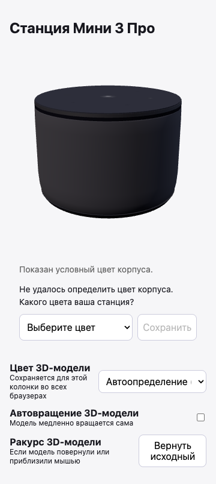
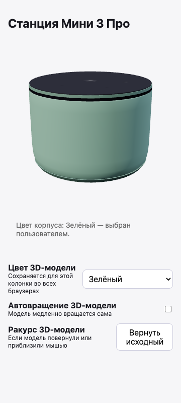

# Цвет корпуса 3D-модели

Если колонка не сообщает поддерживаемый цвет, панель показывает условный корпус и предлагает выбрать цвет под моделью. Первый пункт не выбирается автоматически. После подтверждения выбор хранится на сервере панели и доступен другим браузерам при обновлении страницы. «Настроить → Цвет 3D-модели → Автоопределение» возвращает цвет устройства; без него снова появляется вопрос.

Выбор меняет только изображение. Прошивка, подсветка и другие настройки колонки не меняются. Настройки остаются доступны без WebGL. Во время потери связи вопрос скрывается, последний показанный цвет сохраняется. Ошибка записи отображается пользователю и не подтверждается как успешное сохранение.

## Источник и приоритет

- Успешный `yandex-getcolor` даёт кандидата; регистр/пробелы нормализуются, `gray` соответствует `grey`. Значение должно присутствовать в палитре именно визуальной модели.
- Отсутствующая команда, пустой ответ, ошибка команды и неподдерживаемое значение различаются. Неизвестный цвет не превращается в автоматически определённый чёрный.
- Подтверждённый серверный выбор имеет приоритет над автоматическим. Возврат к авто тоже сохраняется, чтобы старые browser preferences не восстанавливали ручной цвет.
- Прежний локальный выбор сохраняет локальное отображение, пока пользователь не подтвердит перенос. Он не отправляется на сервер при открытии страницы. Уже заданная серверная настройка имеет приоритет.
- Автовращение остаётся локальным. Галерея использует отдельные `model.preview.preferences.*` и не вызывает API цвета колонки.

Общий каталог `static/model-colors.json` используется рендерерами, формой и серверной проверкой. Палитры без часов разделяют каталог своего семейства, но настройки сохраняются под отдельным visual ID. Аппаратные профили и их команды не меняются.

## API и хранение

Существующий `GET /api/status` сохраняет `color` и добавляет:

- `color_detection`: `state` (`available`, `unknown`, `error`) и `reason` (`command_missing`, `empty`, `command_failed` либо `null`). `available` означает, что команда вернула значение; проверка палитры выполняется для visual ID.
- `model_color_device_id`: свежий нативный идентификатор или `null`. Кэш `version()` не используется для привязки цвета.

`GET /api/model-color?model=mini3pro` возвращает `model`, `device_id`, `palette`, `detected`, `selected`, `effective`, `source` (`device`, `user`, `unknown`), `reason` и `configured`. Для неизвестного цвета `effective` равен `null`; неподдерживаемый ответ имеет `reason: unsupported`.

`POST /api/model-color` принимает JSON:

```json
{"model":"mini3pro","color":"green","device_id":"TEST0000000001"}
```

Идентификатор в примере вымышленный. Клиент передаёт `device_id`, полученный в GET: перед сохранением сервер читает его заново и отклоняет устаревшую форму, если по прежнему адресу уже другая колонка. `color: null` возвращает автоопределение. Неизвестные модели/цвета, отсутствующий ID и ошибки записи возвращают ошибку; обычные проверки входа, Origin и доступности колонки сохраняются.

`.model_colors.json` находится в каталоге данных панели/worker и содержит записи по нативному идентификатору и visual ID. Смена IP не меняет привязку. Запись выполняется через временный файл, `fsync` и атомарный `replace`; параллельные потоки не теряют изменения других колонок. Остальные файлы настроек не переписываются. Этот файл содержит идентификаторы устройств и исключён из Git и Docker context.

## Проверка на Мини 3 Про

На factory-прошивке `0.12.1.22.3114898626.20250530.factory-12` проверено чтением: нативный ID доступен, `yandex-getcolor` отсутствует, диагностический результат — `unknown / command_missing`. Это не доказательство принципиальной невозможности определить цвет. Подтверждённого альтернативного источника для этой прошивки нет; декодирование серийного номера и новая облачная авторизация в изменение не входят. Сопровождающий может предложить документированный источник отдельно.

Мини 3 Про имеет чёрный, светло-серый, синий и зелёный варианты: [сообщение Яндекса](https://www.yandex.ru/company/news/02-15-04-2025), [зелёный вариант в официальном магазине](https://alice.yandex.ru/store/products/station-mini-3-pro-100488). RGB материалов подобраны приблизительно по фотографиям, не являются измерениями корпуса.

## Проверки

```sh
python -m unittest discover -s tests -v
node tests/test_model_studio.cjs
node tests/test_model_midi.mjs
npm install --no-save --package-lock=false playwright@1.62.1
npx playwright install chromium
node tests/test_model_color_browser.cjs
```

Браузерный тест сам запускает временный локальный HTTP-сервер с подставными данными. Он не подключается к ADB или реальным колонкам. Проверяет сохранение между браузерами, приоритеты, замену устройства, ошибки, перенос старого выбора, все девять поддерживаемых визуальных моделей, мобильную ширину, клавиатуру, отсутствие WebGL и отдельную галерею. В тестах рендерятся настоящие WebGL-модели; это не проверка физических цветов девяти устройств.

На изображениях — локальный тестовый интерфейс, без данных владельца:

| Цвет неизвестен | Цвет выбран пользователем |
| --- | --- |
|  |  |
