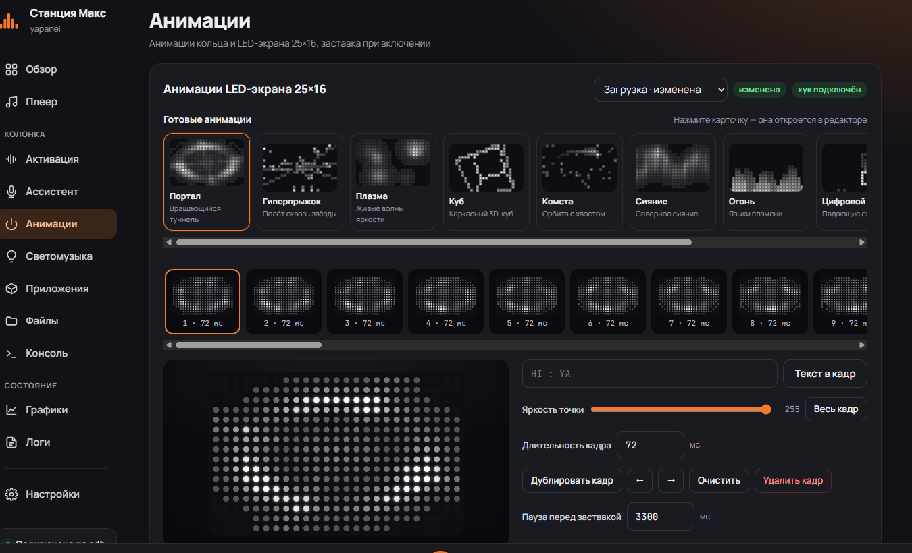
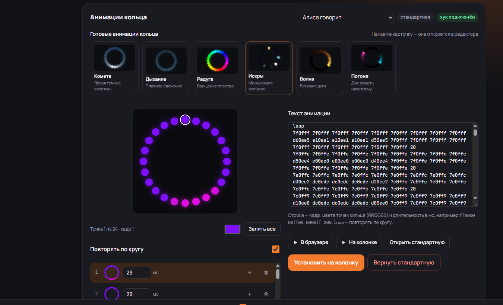

## yapanel 0.3.10 — звуки Bluetooth, галерея анимаций и кольцо, которое снова светится

Этот релиз — про то, чтобы станция выглядела и звучала как твоя, а не как с завода. Внутри сразу пять PR: звуки Bluetooth, десять анимаций для LED-экрана, шесть для кольца и починка кольца, которое до этого молчало.

### Главное

- **Звуки включения и выключения Bluetooth.** Свой джингл на включение, свой на выключение и «тишина вместо фразы» — всё ставится из панели. Нативный демон `bt-memes` глушит фразу Алисы на время переключения, играет выбранный звук и возвращает исходные звуки Quasar при выключении. Автозапуск переживает перезагрузку. Мем-аудио в репозиторий не входит: только `silent.mp3`, остальное загружается через UI. ([#21](https://github.com/Timobzdecc/yapanel-web_max/pull/21))
- **Галерея готовых анимаций.** Десять процедурных анимаций для монохромного экрана 25×16: «Портал», «Гиперпрыжок», «Плазма», «Куб», «Комета», «Сияние», «Огонь», «Цифровой дождь», «Пульс», «Песочные часы». Шесть цветных для кольца: «Комета», «Дыхание», «Радуга», «Искры», «Волна», «Погоня». Превью живое, клик открывает анимацию в редакторе, дальше — обычные «В браузере», «На колонке», «Установить». ([#22](https://github.com/Timobzdecc/yapanel-web_max/pull/22))
- **Кольцо снова работает.** «На колонке» больше не падает с `TypeError`, установка показывает «изменена», а не «стандартная», а после перезагрузки ring-анимации не откатываются. На время проигрывания Quasar ставится на паузу, чтобы не перебивать кадры панели. ([#23](https://github.com/Timobzdecc/yapanel-web_max/pull/23))
- **Редактор кольца для 24 LED.** Вместо стены из 24 цветных `input` в каждой строке — компактные кадры с мини-кольцами, длительностью и кнопками. Цвет выбранной точки меняется одним пикером, «Залить все» красит весь кадр. ([#24](https://github.com/Timobzdecc/yapanel-web_max/pull/24))
- **Тумблер Bluetooth.** Включение и выключение адаптера снова работает из локального root-контекста, а состояние не врёт после нажатия. ([#20](https://github.com/Timobzdecc/yapanel-web_max/pull/20))

### Под капотом

- Демон Bluetooth и его исходник лежат в `device/bt_memes`; бинарник исполняемый, панель ставит его сама.
- Исходные звуки Quasar бэкапятся в `bt-memes/backup` и восстанавливаются при выключении или сбросе.
- Пресеты анимаций детерминированы и не тянут внешних зависимостей; для кольца кадры пакуются в BGR24 и пишутся в `fb5` с паузой Quasar.
- `boot_hook.sh` теперь привязывает ring-override к `ledpatterns`, а clock — к каталогу часов, поэтому кольцо переживает ребут.
- `install_to_max.ps1` пересобран: внутри `device/bt_memes`, `static/anim-presets.js` и `VERSION=0.3.10`.

### Проверено на устройстве

YNDX-0008, прошивка `5000000921`:

- звуки Bluetooth: установка, MUTE/UNMUTE, свои файлы, возврат stock, автозапуск после reboot;
- заставка «Портал» установлена, после перезагрузки `mounted: true` и 41 кадр на месте;
- кольцо: «На колонке» играет, установка «Кометы» и «Дыхания» видна в статусе, bind в `/proc/mounts`, после reboot override сохраняется, сброс возвращает стандарт;
- редактор: «Погоня» — 36 кадров без горизонтального переполнения, выбор точки, смена цвета и «Залить все» работают.

### Тесты

`880 passed, 45 skipped, 56 subtests passed`; CI зелёный на Python 3.9/3.11/3.14, node-тесты (UI, пути, пресеты) проходят.

### Установка

1. Скачайте `yapanel-web-0.3.10-windows-x64.zip` (или `arm64`).
2. Распакуйте и запустите `install_to_max.bat`.
3. Введите IP станции.

После обновления один раз обновите страницу панели: service worker подтянет новый shell.

### Спасибо

- [dimap](https://github.com/dimap/yandex-station-web) — база yapanel-web.
- [Frida](https://frida.re) — `frida-inject`, LGPL-2.1.
- Всем, кто тестировал станцию и присылал «а вот тут кольцо не горит» — это бесценно.

**Полный список изменений:** [`v0.3.9...v0.3.10`](https://github.com/Timobzdecc/yapanel-web_max/compare/v0.3.9...v0.3.10)
